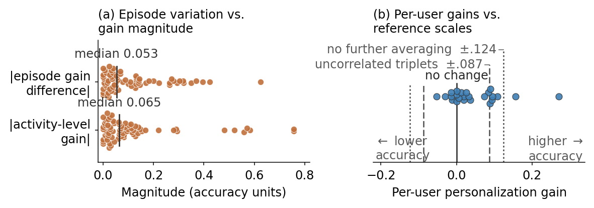

# PersonalizationGain

**How much does a personalization gain move if you measure it on a different
episode?** This repo answers that question and reproduces the results of
*How Precise Is a Personalization Gain? Episode Repeatability in Wearable
Activity Recognition* (NeurIPS 2026 workshop, CL4MAgents). The installable
package is `repgain`.

Cohort-average personalization gains are routinely reported as evidence that
a per-user adapter works. They can be positive on average while being
individually unrepeatable: score the same fixed adapter on a second episode
of the same user and activity, and a meaningful fraction of per-user
conclusions flip.



*(a) The spread between two measurements of the same (user, activity) gain
(orange, top row) is comparable in size to the gain itself (orange, bottom
row) -- a cohort-level effect does not imply a stable per-user number. (b)
Most per-user gains (blue) fall inside the measurement's own noise band
(dashed/dotted reference scales), even though the cohort mean is positive.
Regenerate with `make figures`.*

`repgain` is the diagnostic that catches this, packaged so any
personalization study can run it on its own results:

```python
from repgain import RepeatabilityCheck

check = RepeatabilityCheck(n_boot=2000, seed=0)
report = check.run(df)   # columns: subject, episode, gain [, group]
print(report.summary())
report.plot()
```

`df` needs two measurements of the same (subject, group) cell's gain, taken
from one **fixed** adapter scored on two separate episodes. If you only have
raw scores under two conditions, pass `condition` + `score` columns instead
of `gain` and `RepeatabilityCheck` derives it for you.

## What this measures, concretely

For MotionSense, three of six activities happen to be recorded twice per
participant. Holding out both recordings, fitting one adapter on the rest,
and scoring that same adapter on each held-out recording separately gives two
independent draws of the same (user, activity) gain. The RMS scale of their
difference is the *episode repeatability* reported in the paper:
`sigma = sqrt(mean((gain_1 - gain_2)^2) / 2)`.

## Repository layout

```
assets/              static copy of figures/repeatability.png, committed only
                     so it renders on GitHub -- regenerate with `make figures`
                     and `cp figures/repeatability.png assets/`, never hand-edit
src/repgain/        installable package: the estimator, the bootstrap, the adapter
experiments/        Stage 1 (needs raw MotionSense data): feature extraction,
                     backbone + per-user adapter fitting -> small cached CSVs in results/
analysis/            Stage 2 (CPU only, reads only the cached CSVs in results/):
                     covariance check, stratified repeatability, bootstrap,
                     Figure 1(b) correction, paper macros
paper/               claims.yaml (every reported number -> script -> expected
                     value) and make_figures.py, which regenerates figures/
results/              committed, small, frozen Stage 1 outputs (and the Stage 2
                     outputs they regenerate, gitignored so `make figures`
                     always proves it can reproduce them)
tests/               unit tests for src/repgain, and test_claims.py
```

## Reproducing the paper

```bash
make setup     # uv-managed virtualenv + locked dependencies
make test      # unit tests for src/repgain
make figures   # regenerate figures/ and results/generated_macros.json
               # from the committed results/ cache -- CPU, a few seconds,
               # no dataset download required
make full      # Stage 1: clone MotionSense, extract features, fit the
               # backbone + adapters, refresh results/ -- needs network access
               # and a few minutes on CPU (no GPU is used anywhere)
```

`make test` also runs `tests/test_claims.py`, which recomputes every macro in
`paper/claims.yaml` from the committed cache and checks it against the value
actually printed in the paper.

## Data

The analysis uses one public dataset, [MotionSense](https://github.com/mmalekzadeh/motion-sense)
(MIT License, included at `experiments/MOTIONSENSE_LICENSE.txt`). Raw
recordings are not redistributed here; `make full` fetches them. The
committed files under `results/` are small, deterministic, aggregated
feature/outcome tables (per-window features, per-user gains, per-design
summaries) derived from that data under its MIT terms, not the recordings
themselves.

## Citation

See `CITATION.cff`.

## License

Code is MIT licensed (`LICENSE`). This is independent of the MotionSense
dataset's own MIT license noted above.
